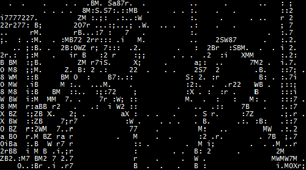

<!-- MedveDux · profile README · terminal edition · RU (English version: README.en.md) -->

<p align="center"></p>

<p align="right"><a href="README.en.md"></a></p>

<p align="center"><a href="https://github.com/MedveDux"><picture><source media="(prefers-color-scheme: dark)" srcset="https://readme-typing-svg.demolab.com/?font=Fira+Code&weight=600&size=22&duration=3200&pause=900&color=00FF41&center=true&vCenter=true&width=600&height=48&lines=%24+whoami;%D0%9C%D0%B8%D1%85%D0%B0%D0%B8%D0%BB+%D0%9C%D0%B8%D1%85%D0%B0%D0%B9%D0%BB%D0%BE%D0%B2%D1%81%D0%BA%D0%B8%D0%B9+%C2%B7+MedveDux;%24+cat+~%2F.plan;%D0%BD%D0%B0%D1%83%D0%BA%D0%B0+%2B+%D0%BA%D0%BE%D0%B4%3A+%D0%BE%D1%82+%D0%B8%D0%B4%D0%B5%D0%B8+%D0%B4%D0%BE+%D1%80%D0%B5%D0%BB%D0%B8%D0%B7%D0%B0;%24+make+medvedux;make%3A+%27medvedux%27+is+up+to+date."></picture></a></p>

<p align="center">  </p>

<p align="center"></p>

## `$ whoami`


Привет! Я **Михаил Михайловский** — для друзей **Миша**, для GitHub **MedveDux**. Ник — от слова «медведь»: работаю спокойно и основательно — и довожу до релиза.

- Аспирант **МГППУ** — активно развиваюсь в науке
- Выпускник **École 42** — peer-to-peer, без преподавателей. Трек C/C++: от своей libc до 3D на raycasting
- Люблю низкий уровень: `C`, указатели, `Makefile`, своя `printf`
- Свои проекты довожу до релизов: версии, установщики, changelog, живые пользователи
- Сейчас: наука, бэкенды на **Go**, инструменты на **Python**, эксперименты с embedded

```c
/* about.c — собрано в École 42: norminette одобряет, peer-review тоже */
#include <stdio.h>

typedef struct s_dev
{
    const char  *name;
    const char  *alias;
    const char  *edu[2];
    const char  *focus[3];
    const char  *langs[6];
    const char  *motto;
}   t_dev;

static const t_dev  me = {
    .name  = "Михаил Михайловский",
    .alias = "MedveDux",
    .edu   = {"аспирант МГППУ", "выпускник École 42"},
    .focus = {"science", "backend", "tools"},
    .langs = {"C", "Go", "Python", "Dart", "Java", "C++"},
    .motto = "инструменты, которые просто работают",
};

int main(void)
{
    printf("Привет, я %s (%s). Пишу на %s, думаю указателями, не боюсь Makefile.\n",
        me.name, me.alias, me.langs[0]);
    return (0);
}
```

## `$ cat ~/research.log`

```bash
medvedux@dev:~$ cat ~/research.log
[status]   аспирант МГППУ · активно развиваюсь в науке
[mode]     исследования параллельно с разработкой
[tooling]  код как инструмент исследования: данные, прототипы, автоматизация
```

<p align="center"><i>Наука для меня — не отдельная вкладка, а вторая половина работы: гипотезы, эксперименты, тексты. Разработка помогает науке прототипами и обработкой данных, а научный подход помогает разработке — измерять, а не гадать.</i></p>

### `$ ls ~/ecole42`



**École 42** — peer-to-peer, без преподавателей: код проверяют такие же студенты, и «ну почти работает» не принимается.

Выпускник. Трек C/C++ — от своей libc до 3D на raycasting: строки и память, процессы и пайпы, потоки и мьютексы, сортировка за минимум операций, модули C++. Отсюда C на первом месте в моих языках и привычка понимать, что происходит под капотом.

<p align="center"><sub>$ make re · 2021 → 2022 · 0 преподавателей, ∞ peer-review</sub></p>

<p align="center"></p>

## `$ cat ~/.skills`

<p align="center"></p>

| Слой | Инструменты |
|:--|:--|
| Низкий уровень | `C` · `C++` · `Makefile` · `CMake` — указатели, процессы, потоки, raycasting |
| Бэкенд | `Go` · `PostgreSQL` · `Docker` + `docker-compose` · SQL-миграции |
| Мобильное | `Dart` / `Flutter` · `Java` (Android) |
| Десктоп и инструменты | `Python` · `NSIS` · `Batch` · `Shell` |
| Игры | `Go` + `Ebiten` · `C` |
| Embedded | `ESP32` · `nanopb` / Protocol Buffers |
| Web и боты | Telegram Mini Apps · `HTML` / `JavaScript` |
| Наука | исследования · данные · прототипы · автоматизация экспериментов |

## `$ git log --oneline`

```bash
medvedux@dev:~$ git log --reverse --date=format:%Y --format="%ad  %s%d"
2021  init: завёл GitHub, бассейн C в École 42
2022  feat(c,cpp): трек C/C++ — от своей libc до raycasting-3D, модули C++
2022  feat(web,android): веб-технологии и первое Android-приложение
2024  feat(dart): Flutter и мобильная разработка
2025  feat(go): бэкенды на Go + PostgreSQL + Docker
2026  feat(release,embedded): релизы v1.0, эксперименты с ESP32 (HEAD -> main)
```

### `$ cat achievements.log`

| | Достижение | Как получено |
|:--:|:--|:--|
| 🦈 | **Pull Shark** | бейдж GitHub за влитые pull request'ы |
| 🎓 | **Выпускник École 42** | трек C/C++ пройден от бассейна до финальных проектов |
| 🔬 | **Аспирант МГППУ** | наука параллельно с разработкой |
| 🚀 | **Релизы, а не черновики** | свои проекты доведены до версий 1.0: установщики, changelog, пользователи |
| 🗣️ | **Полиглот** | C → C++ → Java → Dart → Go → Python, и за каждым языком стоит код |
| 📅 | **Ветеран** | на GitHub с сентября 2021 |

### `$ uptime`

```bash
medvedux@dev:~$ uptime
 up 5 years since 2021-09 · аспирант МГППУ · выпускник École 42
 load: наука · бэкенды на Go · инструменты на Python · embedded
```

<p align="center"><i>Собираю что-то на Go или Python прямо сейчас — <a href="https://t.me/MedveDux">пиши в Telegram</a>, если есть идея или вопрос.</i></p>

<p align="center"></p>

## `$ neofetch`

<p align="center"><picture><source media="(prefers-color-scheme: dark)" srcset="https://github-readme-stats.vercel.app/api?username=MedveDux&show_icons=true&include_all_commits=true&hide_border=true&bg_color=0d1117&title_color=00ff41&icon_color=00ff41&text_color=c9d1d9&ring_color=00ff41&locale=ru&custom_title=%24%20git%20stats%20--all"></picture> <picture><source media="(prefers-color-scheme: dark)" srcset="https://streak-stats.demolab.com/?user=MedveDux&locale=ru&hide_border=true&background=0d1117&ring=00ff41&fire=00ff41&currStreakLabel=00ff41&currStreakNum=c9d1d9&sideNums=c9d1d9&sideLabels=c9d1d9&dates=8b949e&stroke=30363d"></picture></p>

<p align="center"><picture><source media="(prefers-color-scheme: dark)" srcset="https://github-readme-stats.vercel.app/api/top-langs/?username=MedveDux&layout=compact&langs_count=8&hide=objective-c&hide_border=true&bg_color=0d1117&title_color=00ff41&text_color=c9d1d9&locale=ru&custom_title=%24%20cat%20%2Fproc%2Flangs"></picture><br><sub># C лидирует по байтам — это след École 42. Новое пишу на Go и Python.</sub></p>

<!-- Змейка появится после первого прогона .github/workflows/snake.yml (ветка output) -->
<p align="center"><picture><source media="(prefers-color-scheme: dark)" srcset="https://raw.githubusercontent.com/MedveDux/MedveDux/output/github-snake-dark.svg"><source media="(prefers-color-scheme: light)" srcset="https://raw.githubusercontent.com/MedveDux/MedveDux/output/github-snake.svg"></picture><br><sub>Медведь кормит змейку коммитами.</sub></p>

## `$ ping medvedux` · связаться

```bash
medvedux@dev:~$ ping medvedux
PING medvedux (t.me/MedveDux): 56 data bytes
64 bytes from medvedux: icmp_seq=1 ttl=∞ time=«отвечу, как только соберётся»
--- medvedux ping statistics ---
1 packets transmitted, 1 received, 0% packet loss
```

<p align="center"><a href="https://t.me/MedveDux"></a> <a href="https://vk.com/medve_dux"></a> <a href="https://github.com/MedveDux"></a></p>

<p align="center">С радостью обсужу Go, науку и École 42.</p>

<details>
<summary><code>$ sudo make me a sandwich</code></summary>
<p>Okay. А если серьёзно, самый быстрый способ что-то обсудить — <a href="https://t.me/MedveDux">Telegram</a>.</p>
</details>

<p align="center"><br><i>Если какой-то репозиторий пригодился — поставь ⭐. Медведь заметит и обрадуется.</i><br><br><code>Continue? [Y/n] █</code></p>

<p align="center"></p>
